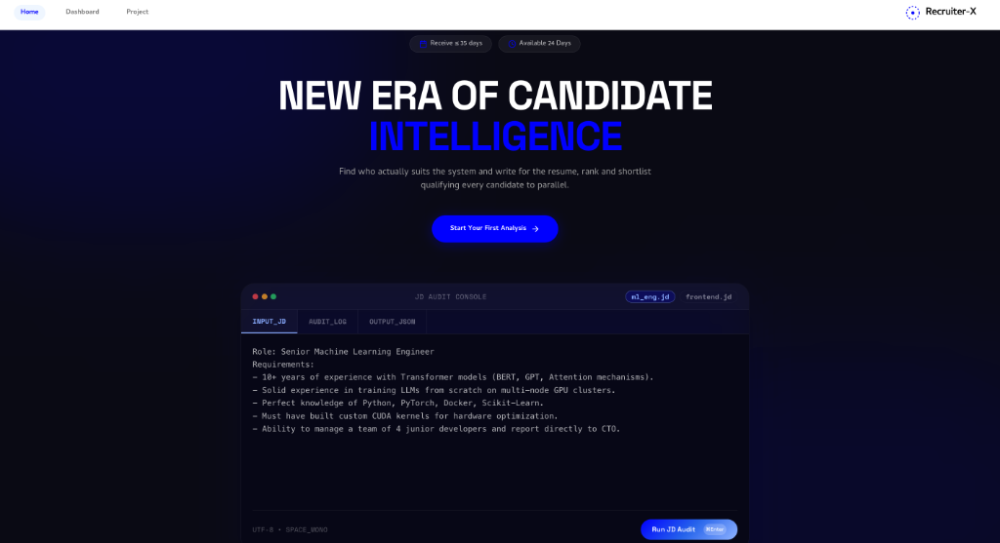
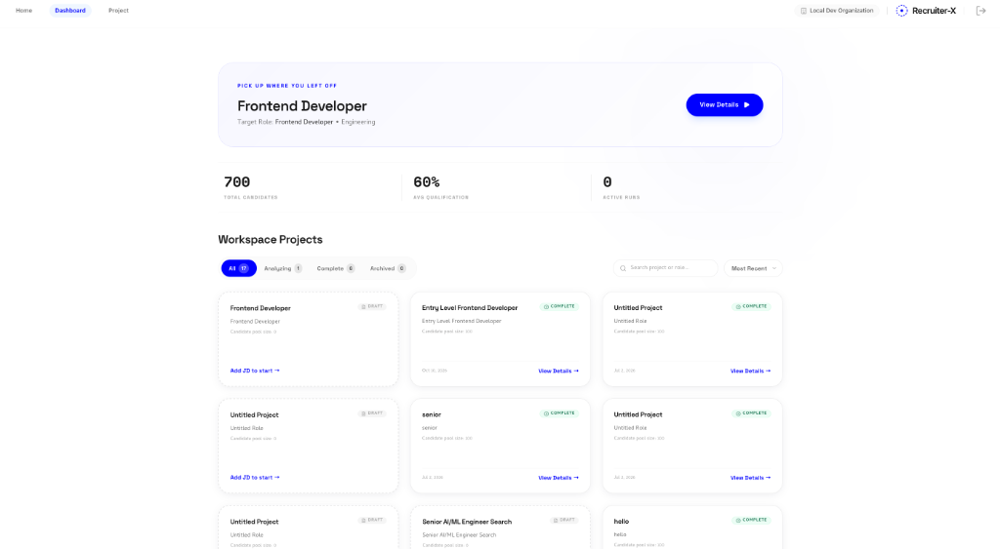
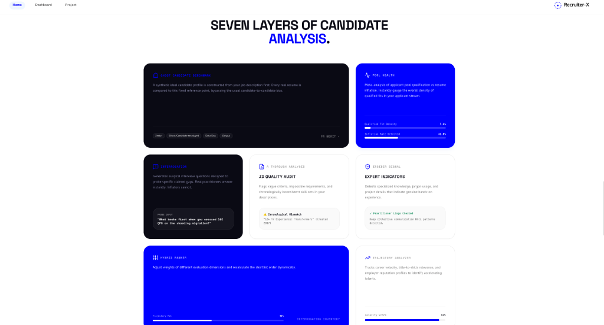
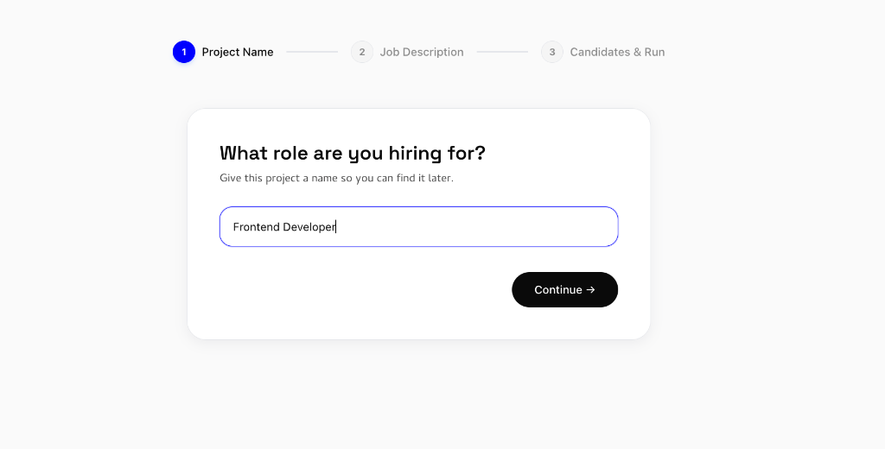
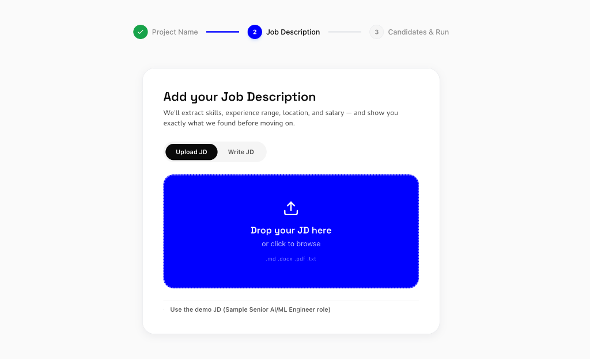
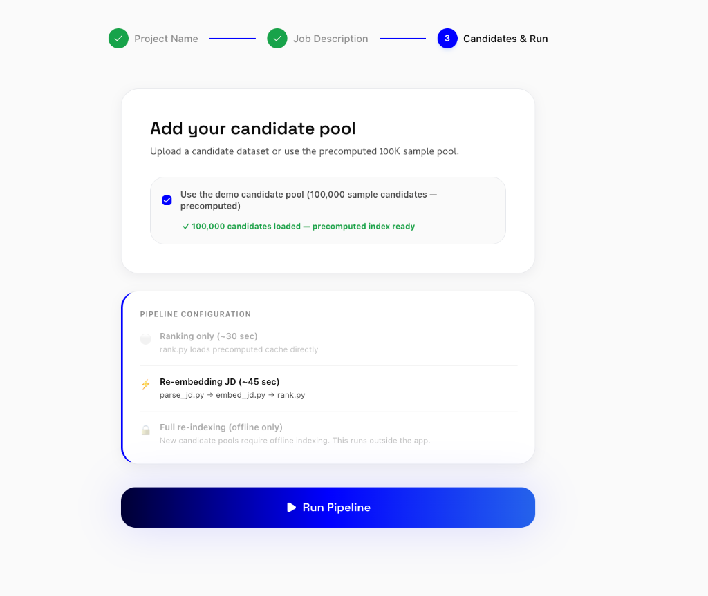
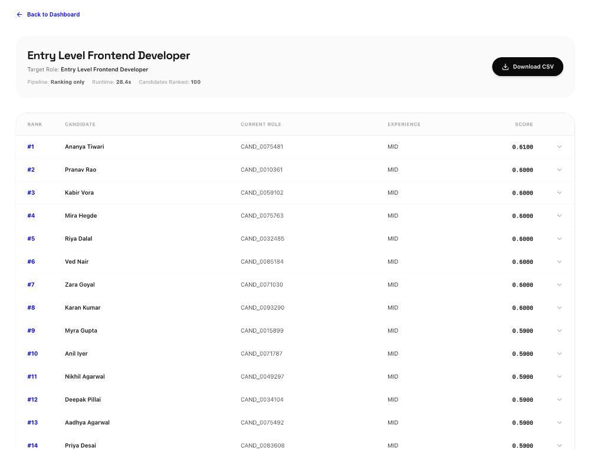

# 🚀 RecruiterX — AI Candidate Intelligence & Ranking Platform

RecruiterX is a state-of-the-art candidate evaluation and talent ranking platform designed to streamline hiring workflows. It combines a Next.js recruiter interface with a FastAPI backend database and a high-performance vector ranking engine to parse job descriptions, score candidate pools, and surface top talent in real-time.

---

## 📸 Platform Interface & Key Features

### 1. Hero Landing Page & Real-Time Audit Console

* **Candidate Intelligence Portal**: Displays platform stats, live audit controls, and quick-start workflow actions.
* **Interactive JD Audit Console**: Real-time inspection of input job descriptions, active parsing logs, and extracted structured JSON outputs.

---

### 2. Workspace Dashboard & Talent Metrics

* **Analytics Overview**: Tracks key metrics including Total Candidates, Average Qualification Score, and Active Evaluation Runs.
* **Project Management Hub**: Grid view of all active hiring projects, status badges (`DRAFT`, `ANALYZING`, `COMPLETE`), candidate pool sizes, and quick project actions.

---

### 3. Seven Layers of Candidate Analysis

* **Ghost Candidate Benchmark**: Compares real candidates against a synthetic ideal reference profile created from the job description.
* **Pool Health & Inflation Analytics**: Evaluates qualification density vs. resume inflation rates across the applicant stream.
* **JD Quality Audit & Insider Signals**: Flags vague criteria, inconsistent skill claims, and detects practitioner-level jargon.
* **Interrogation Generator**: Generates targeted technical questions to probe specific candidate skill gaps.
* **Hybrid Ranker & Trajectory Analyzer**: Dynamic multi-dimensional scoring engine tracking career velocity and employer prestige.

---

### 4. Project Setup & Role Definition

* **Role Initialization**: Step 1 of project creation — assign a target role title and project name (e.g., *Frontend Developer*, *Senior AI/ML Engineer*) to begin candidate evaluation.

---

### 5. Multi-Format Job Description Parsing

* **Multi-Format Ingestion**: Drag-and-drop support for `.pdf`, `.docx`, `.md`, and `.txt` job description files.
* **Automated Feature Extraction**: Instantly extracts required skills, nice-to-have skills, experience ranges, salary bands, locations, and work modes.

### 6. Candidate Pool Selection & Pipeline Execution

* **Dataset Selection**: Step 3 of project setup — choose between custom candidate uploads or precomputed 100K datasets.
* **Pipeline Configuration Modes**: Select execution mode (`Ranking only ~30s`, `Re-embedding JD ~45s`, or `Full re-indexing`) and trigger the automated evaluation run.

---

### 7. Ranked Candidate Shortlist & Exportable Leaderboard

* **Vectorized Shortlist Generation**: Displays ranked candidates with fit scores, anonymized IDs, experience levels, and current roles.
* **One-Click Export**: Allows recruiters to download the shortlisted candidate scores as a formatted `.csv` submission file.

---

## 🛠️ Architecture Overview

```
RecruiterX/
├── src/                        # Next.js 14 Frontend Portal (React, TypeScript, Tailwind)
├── api/                        # FastAPI Backend API (SQLAlchemy, SQLite)
├── redrob-ranker/              # Vector Ranking Engine (Python, SentenceTransformers)
│   ├── parse_jd.py             # PDF/DOCX/TXT Parser & Skill Extractor
│   ├── embed_jd.py             # Vector Embedding Generator
│   └── rank.py                 # Multi-Layer Candidate Ranker
└── database.db                 # Local SQLite Database
```

---

## 🚀 Quick Start Guide

### Prerequisites
* **Node.js**: v18.0 or higher
* **Python**: v3.10 or higher

---

### Running the Full-Stack Application

1. **Set Up Python Virtual Environment**:
   ```bash
   python3 -m venv redrob-ranker/.venv
   redrob-ranker/.venv/bin/pip install -r redrob-ranker/requirements.txt
   redrob-ranker/.venv/bin/pip install fastapi uvicorn sqlalchemy pypdf pdfplumber
   ```

2. **Install Node.js Dependencies**:
   ```bash
   npm install
   ```

3. **Start Concurrent Servers**:
   ```bash
   npm run dev
   ```
   * Runs Next.js frontend at [http://localhost:3000](http://localhost:3000)
   * Runs FastAPI backend API at [http://127.0.0.1:8000](http://127.0.0.1:8000)

---

## 📊 Candidate Scoring Methodology

| Evaluation Dimension | Weight | Description |
|---|---|---|
| **Skill Match** | `40%` | Vector similarity + structured skill overlap + verified assessment scores |
| **Experience Fit** | `25%` | YoE band alignment + trajectory relevance weighting |
| **Behavioral Signals** | `20%` | Responsiveness, reachability, GitHub activity, & offer acceptance history |
| **Education Tier** | `8%` | Tiered institutional scoring (Tier 1, Tier 2, Tier 3/4) |
| **Logistics Fit** | `7%` | Preferred location match + work mode + notice period compatibility |

---

## 📄 License

Distributed under the MIT License. See `LICENSE` for details.
